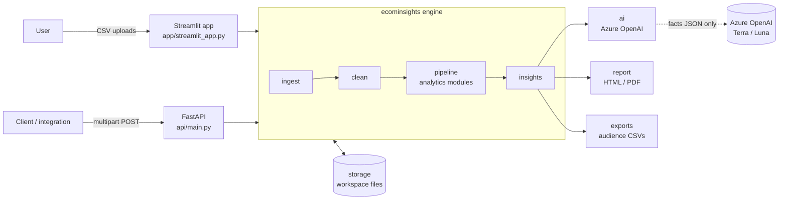
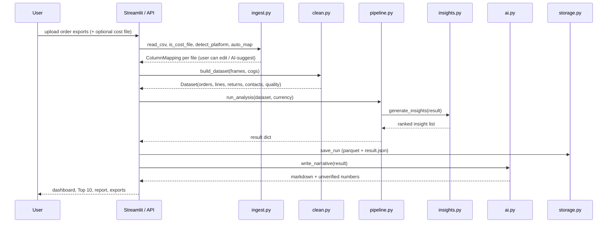

# Architecture

How the backend turns uploaded CSVs into ranked insights, reports and exports.

## Design principles

1. **Math decides, AI explains.** Every metric, segment, forecast and $ impact is computed by
   deterministic Python. The language model never calculates anything. It maps column headers,
   writes prose from a JSON of computed facts, and answers questions about those facts.
2. **Verify what the AI writes.** Every number in the AI narrative is checked against the facts
   it was given. Numbers that can't be matched are shown to the user as warnings.
3. **One engine, many front-ends.** All logic lives in the `ecominsights` package. The Streamlit
   app (`app/`) and the FastAPI service (`api/`) are thin layers over the same functions.
4. **Fail soft.** Each analysis module runs in isolation. If one fails or the data can't support
   it, the rest of the report is still produced, and the gap is reported.
5. **Privacy by default.** Personal columns are dropped on upload, customer identifiers are
   hashed, and raw rows never leave the server (only headers and masked samples go to the AI).

## System overview



## Request lifecycle



Typical timings with sample data (~4k rows): ingest and clean take about 1 s, analytics about 1–5 s,
and the AI review about 30 s. A 20 MB file (about 140k rows) cleans in about 9 s.

## Code layout

```
src/ecominsights/
  schema.py        canonical fields, header synonyms, platform fingerprints, ColumnMapping
  ingest.py        CSV reading, platform detection, header mapping, cost-file detection
  clean.py         canonical Dataset: orders / lines / returns / contacts + data-quality score
  pipeline.py      runs every analysis module, collects results, JSON serialization
  analytics/
    kpis.py        30/90/365-day snapshots, KPI tree (LMDI), mix-shift attribution, monthly series
    customers.py   customer table, RFM scoring and segments, top-10 lists, repeat behaviour
    clv.py         BG/NBD + Gamma-Gamma lifetime value, holdout backtest
    cohorts.py     retention matrix, LTV curves, first-product and discount cohorts
    products.py    ABC/Pareto, momentum, basket affinity, stock-outs, replenishment, returns
    timeseries.py  seasonality, weekday×hour, anomalies, trend, Holt-Winters forecast
    channels.py    multi-channel / multi-store comparison
  insights.py      insight candidates, $ impact formulas, confidence, ranking
  benchmarks.py    indicative DTC benchmark ranges
  ai.py            Azure OpenAI: column mapping, narrative, Q&A, number verification, rule fallback
  charts.py        Plotly figures shared by the app and the report
  report.py        HTML report and PDF (headless Chromium via Playwright)
  exports.py       audience files for Klaviyo / Mailchimp / Meta / Google
  storage.py       workspaces, runs, saved mappings, run comparison, retention
app/streamlit_app.py   UI
api/main.py            REST API
scripts/make_sample_data.py   synthetic Shopify + Amazon + cost files with planted patterns
tests/                 engine and API tests
```

## Stage 1 – Ingest (`ingest.py`, `schema.py`)

**Input:** raw file bytes (≤ 20 MB per file).

1. **Read.** Tries UTF-8 (with/without BOM), CP1252 and Latin-1 in turn, sniffs the delimiter
   (`,` `;` tab `|`), and reads every column as text so bad values can be counted rather than
   crashing.
2. **Classify the file.** `is_cost_file` treats a file with a cost column plus a SKU/product key
   and no order date or quantity as a **product cost file**. That includes Shopify's product
   export (`Variant SKU`, `Cost per item`). Everything else is an **order export**. The user can
   override the type per file.
3. **Detect the platform** from header fingerprints: Shopify, Amazon, WooCommerce, Online Retail,
   otherwise `generic`.
4. **Map headers** onto the canonical fields. Headers are normalized (lowercase, alphanumeric), then:
   - **exact** match against the synonym lists, in priority order (e.g. `Subtotal` before `Total`,
     because totals include tax and shipping);
   - **fuzzy** match (RapidFuzz ratio ≥ 88) for anything left;
   - **AI** fill-in for missing fields, on request (see Stage 6);
   - an email column is reused as the customer ID when no ID column exists;
   - platform fix-ups, e.g. Amazon `item-price` is a line total, not a unit price.
5. **Drop PII.** Columns that look like names, phones, addresses or postcodes are excluded.

Mappings are saved per workspace, keyed by a hash of the header set, so the same export layout
is mapped automatically next time.

### Canonical fields

| Level | Fields |
|---|---|
| Order | `order_id`\*, `order_date`\*, `customer_id`, `email`, `order_total`, `discount`, `refund`, `status`, `currency`, `country`, `region`, `channel`, `fees`, `discount_code` |
| Line | `product`, `sku`, `category`, `quantity`, `unit_price`, `line_total`, `unit_cost` |

\* Required. At least one revenue field (`order_total`, `line_total` or `unit_price`) is also required.

## Stage 2 – Clean (`clean.py`)

**Output:** a `Dataset` holding `orders`, `lines`, `returns`, `contacts` and `quality`.

**Revenue definition used everywhere:** net of discounts and refunds, before tax and shipping.
Cancelled, test and fully refunded orders are excluded.

Steps, applied per uploaded file:

| Step | What happens |
|---|---|
| Standardize | Rename mapped columns; parse money (`$1,234.50`, `(12.00)`, `1.234,50`) and dates (timezone offsets dropped so the hour of day stays local wall-clock time) |
| Order-level fill | Exports with one row per line item (Shopify) only fill order fields on the first row; these are forward-filled within each order |
| Drop | Exact duplicate rows, rows without an order ID or a valid date, and statuses that mean cancelled (per-platform list) |
| Line revenue | `line_total`, or `unit_price × quantity` (or `unit_price` alone where the platform reports totals) |
| Customer key | `sha256(APP_SALT + id)` truncated to 16 hex chars. Analytics only ever sees this key |
| Non-merchandise | `classify_lines` tags postage/shipping, fees, manual adjustments, samples and test items by SKU and name. These lines are excluded from revenue and product analytics |
| Returns | Negative quantities or `C…` invoices. `match_returns` links each return to the most recent earlier purchase line with the same customer, product and quantity; that line is removed. Order-level totals (e.g. Shopify subtotal) get the matched value booked as a refund instead |
| Orders | Group lines by order. Gross revenue is `order_total` when present, otherwise line sum − discount. Revenue is gross − refunds. Fully refunded orders are dropped |
| Costs | Optional cost file joined to lines by SKU (or product name) → `line_cost`, order `cogs` |
| Sequence | `order_seq` per customer, `is_returning`, `first_order_date` |
| Multi-file | Each file keeps its channel label. `order_key = channel:order_id`, so identical IDs from two stores don't collide |

**Data-quality score (0–100).** A weighted average of eight checks: customer-ID coverage, valid
dates, duplicates, product detail, history length, product costs, revenue sanity and single
currency. Each check lists the analyses it blocks; for example, without customer IDs there are no
RFM segments, cohorts or CLV.

## Stage 3 – Analytics (`pipeline.py`, `analytics/`)

`run_analysis` calls each module through `_safe()`. Exceptions are recorded in
`meta.module_errors` and do not stop the run. Modules that need data the upload lacks (customer
IDs, products, more than one channel, a year of history) are skipped.

### KPIs and drivers (`kpis.py`)

- **Horizons:** last 30/90/365 days, compared with the previous equal-length period and with the
  same period a year earlier.
- **KPI tree:** `Revenue = Orders × AOV`, `Orders = Customers × Orders per customer`,
  `AOV = Units per order × Price per unit`.
- **LMDI decomposition.** Shows how many $ each driver added or removed. The contributions sum
  exactly to the revenue change:
  `contribution(x) = L(R₁, R₀) · ln(x₁ / x₀)`, where `L(a, b) = (a − b) / (ln a − ln b)`.
- **Mix-shift attribution:** the 90-day revenue change split by channel, country, new vs
  returning, discounted vs full price, category and product.

### Customers and value (`customers.py`, `clv.py`)

- **RFM:** recency, frequency and monetary value, each scored 1–5 by quintile rank. The R × FM grid
  gives 11 segments (Champions, Loyal, At Risk, Can't Lose Them, Hibernating, …), each with a
  recommended play.
- **BG/NBD** (purchase frequency and dropout) with **Gamma-Gamma** (spend per order), fitted by
  maximum likelihood (SciPy L-BFGS-B, light L2 penalty) on repeat purchases `x`, recency `t_x`
  and age `T`, in weeks:
  - `p_active` = probability the customer is still active;
  - `expected_orders_12m` = expected orders in the next 52 weeks;
  - `predicted_12m_value = expected_orders_12m × E[order value]`, undiscounted.
- **Backtest:** refits on data up to 180 days before the end and compares predicted with actual
  holdout orders (total error, MAE, correlation). The UI labels the predictions weak when the
  error is above 30% or the correlation below 0.5.
- **Fallback:** a recency/gap heuristic when there are fewer than 50 customers or 10 repeat buyers.
- **Top-10 lists:** VIPs (by predicted value), high-value at-risk customers, win-back targets,
  rising new customers.

### Cohorts (`cohorts.py`)

- Monthly acquisition cohorts: a retention matrix (% of the cohort ordering in month k) and
  cumulative revenue per acquired customer.
- **First-product cohorts:** repeat rate and 180-day value by the product of the first order;
  this is how gateway products are found.
- **Discount cohorts:** repeat rate when the first order used a discount vs full price, tested
  with a two-proportion z-test.

### Products (`products.py`)

- **Pareto/ABC:** class A is the first 80% of revenue, B the next 15%, C the rest.
- **Momentum:** last 90 days vs the prior 90 days per product.
- **Basket affinity:** for product pairs in multi-item orders,
  `support = P(A∧B)`, `confidence = P(B|A)`, `lift = P(A∧B) / (P(A)·P(B))`.
- **Stock-outs.** Time is counted in *open days* (days the store had any order), so closures and
  weekends don't count. For each zero-sales gap, the product's selling rate is measured over the
  60 open days before and after the gap, using the slower side (so seasonal items aren't flagged).
  Under a Poisson model, a gap is flagged when the expected number of selling days in it is ≥ 8,
  i.e. p < 0.04%. Each side needs at least 30 open days of history.
- **Replenishment:** median days between repeat purchases of the same product, its regularity,
  and the customers currently inside their reorder window.
- **Returns:** return rate and value by product. **Margin:** gross profit and margin by product
  when costs were uploaded.

### Time series (`timeseries.py`)

- **Seasonality:** monthly revenue divided by a log-linear trend, averaged by calendar month.
- **Weekday × hour** revenue heatmap.
- **Anomalies:** robust z-score of daily revenue, `0.6745·(x − median₂₈) / MAD₂₈`; |z| ≥ 3.5 is
  flagged as a spike or dip.
- **Forecast:** Holt-Winters on weekly revenue (damped additive trend, yearly seasonality with ≥ 2
  years of data) for 13 weeks, with an 80% interval from the residuals.

### Channels (`channels.py`)

Revenue, share, growth, AOV, repeat rate and margin per channel, plus the number of customers who
bought in more than one channel (matched on the hashed identifier).

## Stage 4 – Insights and ranking (`insights.py`)

Each detector turns analysis output into an `Insight` with a finding, an action, an estimated
annual impact and the formula behind it:

```
priority score = impact × confidence × actionability / effort
```

- **Impact:** an annual $ estimate from a transparent, conservative formula, shown on every card.
  For example, for at-risk customers: their annualized spend × a 15% win-back rate.
- **Confidence (0–1):** from sample size, `0.3 + 0.65·(1 − e^(−n/half))` capped at 0.95, or from
  the p-value where there is a statistical test.
- **Actionability and effort:** 1–3 ratings per insight type.

Detectors cover: the biggest negative and positive KPI-tree driver, segment drops, at-risk
customers, Champions, repeat rate vs benchmark, discount-acquired churn, gateway products, bundle
pairs, stock-outs, declining and rising products, low-margin best-sellers, revenue concentration,
replenishment, channel growth and decline, upcoming seasonal peaks, best weekday, recent dips,
discount depth and the forecast. The sorted list's first 10 entries are the **Top 10**.

Benchmarks (`benchmarks.py`) are indicative DTC ranges, used for one insight and the benchmark
chart. They are meant to be edited per category.

## Stage 5 – Result object

`run_analysis` returns a dict that every consumer reads:

| Key | Content |
|---|---|
| `meta` | sources, quality report, currency, module errors |
| `snapshot`, `attribution`, `monthly` | KPIs, KPI trees, mix-shift |
| `customers`, `segments`, `top_lists`, `repeat`, `clv_model` | customer analytics (per-customer table kept server-side) |
| `cohorts`, `first_product`, `discount_cohorts` | cohort analytics |
| `products`, `pareto`, `basket`, `stockouts`, `replenishment`, `due_reorder`, `returns` | product analytics |
| `weekly`, `forecast`, `anomalies`, `weekday`, `seasonality`, `trend` | time series |
| `channels`, `channel_monthly` | multi-channel (only with 2+ channels) |
| `benchmarks`, `insights` | comparisons and the ranked list |

`to_json` serializes it (DataFrames to records, NaN to null). The per-customer table is dropped by
default.

## Stage 6 – AI layer (`ai.py`)

Uses Azure OpenAI through the `openai` SDK (`AzureOpenAI`). If credentials aren't configured,
everything falls back to rule-based output.

| Use | Deployment | Model sees |
|---|---|---|
| Column mapping | `AZURE_OPENAI_DEPLOYMENT_MINI` (e.g. gpt-5.6-luna) | headers + 5 sample values per column, with emails and long digit runs masked; PII columns excluded |
| Executive review | `AZURE_OPENAI_DEPLOYMENT` (e.g. gpt-5.6-terra) | `build_facts()`: KPIs, top insights with impacts and formulas, segment totals, benchmarks, repeat stats, channel totals. No customer-level rows |
| Q&A chat | same | the same facts, plus the last 6 chat turns |

**Guardrails:**
- The system prompt restricts the model to numbers in the facts and requires `[insight_id]` citations.
- `verify_numbers` extracts every number in the output (money, %, k/M suffixes) and checks it
  against all numbers in the facts, within rounding. Unmatched numbers are shown as a warning.
- On any API error, the rule-based narrative is used and the error is surfaced.
- No `temperature` or token-limit parameters are sent, so reasoning and non-reasoning
  deployments both work.

## Stage 7 – Outputs

- **Dashboard** (`app/streamlit_app.py` with `charts.py`): 10 tabs, with every chart built from
  the result object. Charts use a fixed, colorblind-checked palette and a single y-axis.
- **Report** (`report.py`): self-contained HTML (KPI tiles, AI review, Top-10 cards with their
  supporting charts, trends, segments, benchmarks, method notes). The **PDF** is the same HTML in a
  light print layout, rendered by headless Chromium (`playwright install chromium` once).
- **Audience exports** (`exports.py`): per-segment contact lists as generic CSV, Klaviyo,
  Mailchimp, or SHA-256-hashed emails for Meta and Google Customer Match. These need the
  "keep customer emails" option.

## Storage (`storage.py`)

Local files under `DATA_DIR` (default `data/workspaces/`), one folder per workspace:

```
<workspace>/
  mappings.json                 saved column mappings, keyed by header signature
  runs/<run_id>/
    orders.parquet  lines.parquet   canonical data (hashed customer keys)
    customers.parquet               RFM / CLV table
    contacts.parquet                customer_key → email (only if the user allows it)
    result.json                     aggregated results (no per-customer rows)
    run.json                        metadata: time, files, counts, quality score
```

- **Workspaces:** the Streamlit app keeps the workspace ID in the URL (`?ws=…`); bookmark it to
  come back. There is no sign-in yet, so anyone with the link can open the workspace.
- **History:** `compare_runs` diffs two uploads: KPI changes, insights that entered or left the
  Top 10, and a segment migration matrix (customers moving between RFM segments).
- **Retention:** `purge_expired` deletes runs older than `RETENTION_DAYS`, but nothing schedules
  it yet. "Delete all my data" removes the workspace.

The interface is designed so Postgres plus object storage can replace the file backend later
without changing callers.

## REST API (`api/main.py`)

| Method | Path | Purpose |
|---|---|---|
| GET | `/health` | liveness and whether AI is configured |
| POST | `/v1/mapping/suggest` | detect platform and propose a mapping (optionally AI) for one file |
| POST | `/v1/analyze` | `files` (orders and optional cost files, auto-detected), `channels`, `mappings`, `currency`, `workspace`, `keep_contacts`, `narrative`. Returns the result JSON, `run_id` and narrative |
| GET | `/v1/workspaces/{ws}/runs` | list runs |
| GET | `/v1/workspaces/{ws}/runs/{run_id}` | stored result |
| GET | `/v1/workspaces/{ws}/compare?previous=&latest=` | run comparison |
| GET | `/v1/workspaces/{ws}/runs/{run_id}/report.html` | HTML report rebuilt from the stored JSON |
| GET | `/v1/workspaces/{ws}/runs/{run_id}/audience?segments=&fmt=` | audience export |
| DELETE | `/v1/workspaces/{ws}` | delete a workspace |

If `API_KEY` is set, every `/v1` call must send it as the `X-API-Key` header. Analysis is
synchronous; this is fine at ≤ 20 MB per file.

## Running locally

```bash
uv sync
uv run playwright install chromium             # one-time: headless browser for PDF export
uv run python scripts/make_sample_data.py      # synthetic Shopify + Amazon + product-cost files
uv run streamlit run app/streamlit_app.py      # UI  -> http://localhost:8501
uv run uvicorn api.main:app --port 8000        # REST API -> http://localhost:8000/docs
uv run pytest -q                               # tests
```

Copy `.env.example` to `.env` first. Without Azure settings the app runs in rule-based mode: the
same analytics, a template-written review, and no chat.

## Configuration (`.env`)

| Variable | Purpose |
|---|---|
| `AZURE_OPENAI_ENDPOINT`, `AZURE_OPENAI_API_KEY`, `AZURE_OPENAI_API_VERSION` | Azure OpenAI connection |
| `AZURE_OPENAI_DEPLOYMENT` | narrative and Q&A deployment |
| `AZURE_OPENAI_DEPLOYMENT_MINI` | column-mapping deployment (falls back to the main one) |
| `APP_SALT` | salt for hashing customer identifiers (keep secret, set per environment) |
| `DATA_DIR` | workspace storage location |
| `RETENTION_DAYS` | age after which `purge_expired` deletes runs |
| `API_KEY` | optional key required by the API |

## Testing and validation

- `tests/test_engine.py`: header mapping, money parsing, Shopify line-item → order dedupe, KPI-tree
  contributions summing exactly, planted-pattern detection on the samples, number verification,
  returns matching and non-merch exclusion, BG/NBD parameter recovery from simulated data.
- `tests/test_api.py`: API-key enforcement and single-upload cost-file detection.
- **Real data:** UCI Online Retail II (1.07M rows, UK wholesaler). It runs end to end, and the CLV
  backtest predicted 1,090 vs 1,193 actual holdout orders (−8.6%, correlation 0.91).

## Known limits

- No sign-in: workspaces are protected only by their unguessable URL.
- Single-process local storage; contact emails are not encrypted at rest; the retention purge is
  not scheduled.
- Analysis runs synchronously (no job queue).
- Benchmarks are indicative; the WooCommerce mapping has not been tested on a real export.
- Impact estimates are directional, for ranking, not forecasts.
